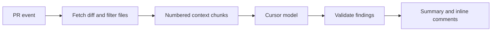

# Code Review Agent

A GitHub Action that reviews pull requests for real problems (bugs, security issues, logic errors and performance) and posts a summary plus inline comments, using your own Cursor API key.

Every finding is checked before it is posted: the quoted code has to exist at the cited line, the line has to be part of the diff, and weak findings are filtered out. You get a few useful comments instead of a wall of noise.

## Features

- **Focused review:** bugs, security, logic and performance only. No style nits.
- **Validated findings:** evidence must match the code, lines must be commentable in the diff, and confidence and severity thresholds apply. High and critical findings get a second verification pass.
- **Inline comments with suggestions:** small fixes come as GitHub suggestion blocks you can apply in one click.
- **Incremental reviews:** on new pushes, only the commits since the last review are reviewed, and issues already reported are not repeated.
- **Skips noise:** lockfiles, vendored and build output, generated, minified and binary files, and oversized diffs.
- **Per-repo config:** include/exclude globs, thresholds and extra instructions in `.github/ai-review.yml`.
- **Safe on PRs:** never checks out or runs PR code; it reads the diff through the GitHub API.

## Quick start

1. Create a Cursor API key at [Cursor Dashboard > Integrations](https://cursor.com/dashboard/integrations).
2. In the repository you want reviewed, add it as a secret named `CURSOR_API_KEY` (Settings > Secrets and variables > Actions).
3. Add `.github/workflows/ai-review.yml`:

```yaml
name: AI review

on:
  pull_request:
    types: [opened, synchronize, reopened, ready_for_review]

permissions:
  contents: read
  pull-requests: write

concurrency:
  group: ai-review-${{ github.event.pull_request.number }}
  cancel-in-progress: true

jobs:
  review:
    runs-on: ubuntu-latest
    timeout-minutes: 20
    steps:
      - uses: gurusanjay2322/Code-Review-Agent@v1
        with:
          cursor-api-key: ${{ secrets.CURSOR_API_KEY }}
```

Open a pull request and the review appears as a comment from `github-actions[bot]`.

## Inputs

| Input | Default | Description |
|---|---|---|
| `cursor-api-key` | required | Cursor API key. Store it as a secret. |
| `github-token` | `${{ github.token }}` | Token used to read the PR and post the review. |
| `model` | `composer-2.5` | Cursor model ID. |
| `min-severity` | `low` | Lowest severity to report: `low`, `medium`, `high`, `critical`. |
| `min-confidence` | `0.6` | Drop findings below this model confidence (0 to 1). |
| `max-comments` | `15` | Maximum inline comments; extra findings go into the summary. |
| `max-files` | `50` | Maximum files reviewed per run. |
| `max-total-tokens` | `60000` | Approximate prompt-token cap per run, to bound plan usage. |
| `concurrency` | `2` | Parallel model calls. |
| `verify` | `true` | Double-check high and critical findings before posting. |
| `fail-on` | `none` | Fail the job when findings at or above this severity are posted. |

Example with stricter settings that block merges on critical issues:

```yaml
      - uses: gurusanjay2322/Code-Review-Agent@v1
        with:
          cursor-api-key: ${{ secrets.CURSOR_API_KEY }}
          min-severity: medium
          fail-on: critical
```

## Repository configuration

Optionally add `.github/ai-review.yml` to the reviewed repository. It is read from the PR's **base** commit, so a pull request cannot change its own review settings.

```yaml
enabled: true
include:
  - "src/**"
exclude:
  - "src/legacy/**"
  - "**/*.test.ts"
min_severity: medium
min_confidence: 0.7
max_comments: 10
instructions: |
  Money amounts are integers in cents; flag any floating point arithmetic on them.
  All handlers under src/api must check req.user before touching the database.
```

All keys are optional. `include` and `exclude` use `**` globs; exclude wins.

## Pull requests from forks

With the `pull_request` trigger, GitHub does not give fork PRs access to secrets, so they are not reviewed. To review them, change the trigger to `pull_request_target`:

```yaml
on:
  pull_request_target:
    types: [opened, synchronize, reopened, ready_for_review]
```

This is safe with this action because it never checks out or executes PR code. Do not add a step that checks out the PR head to the same workflow.

## Usage and cost

Reviews run on your Cursor plan and count toward its usage. Each review is split into chunks of about 12k tokens, with one model call per chunk plus one verification call for high-severity findings. To use less:

- lower `max-total-tokens` or `max-files`
- set `verify: false`
- exclude paths that don't need review in `.github/ai-review.yml`

## How it works



1. Fetches the changed files and skips the ones not worth reviewing.
2. For each change, builds an excerpt with about 40 lines of context and new-file line numbers, plus the top of the file.
3. Sends the excerpts to a Cursor agent with no tools, so it can only judge the code it is shown, and asks for structured JSON findings.
4. Validates each finding against the real file and diff, dedupes it against comments already on the PR, and caps the number of inline comments.
5. Posts one review: a summary, plus inline comments that carry a hidden fingerprint so later runs don't repeat them.

## Self-hosting as a GitHub App

The same pipeline can also run as a GitHub App with a webhook server, a queue and a separate engine service. This is useful for installing once across an organization or for a custom bot identity. It needs a GitHub App, Redis and a server that is reachable from the internet.

1. Create a GitHub App with these permissions: Pull requests (read and write), Contents (read), and optionally Checks (read and write). Subscribe it to the **Pull request** event and set the webhook URL to `https://<your-host>/webhooks/github`.
2. Copy `.env.example` to `.env` and fill in the App ID, webhook secret and `CURSOR_API_KEY`. Save the App's private key as `secrets/github-app.pem`.
3. Run `docker compose up --build`.
4. Install the App on your repositories.

For local testing, forward webhooks with [smee.io](https://smee.io) or `ngrok http 8080`.

## Development

```text
gateway/   Go: webhook server, worker, Action entrypoint, diff parsing, filtering, validation, publishing
engine/    Node: review engine (HTTP server and CLI), prompts, Cursor and Gemini providers
action.yml Action definition
Dockerfile Action image (Go binary + Node engine)
```

```bash
cd gateway && go test ./...
cd engine && npm install && npm test
```

Requirements: Go 1.26+, Node 22.13+.
